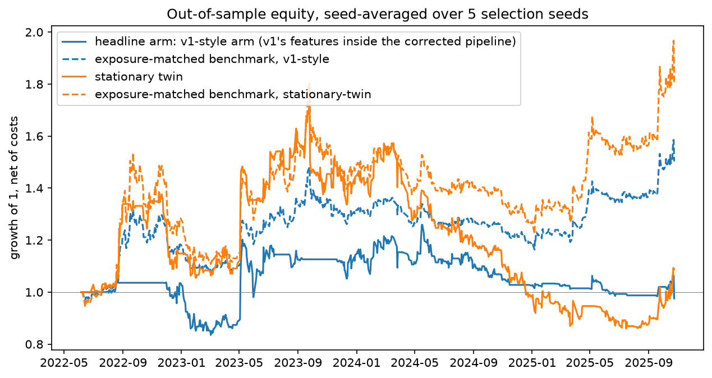

# Financial ML Regime Analysis

A pre-registered walk-forward backtest of a machine-learning trading strategy on one Indonesian stock, PT Kencana Energi Lestari (KEEN.JK). It asks one question: **did the original version's out-of-sample failure come from its raw price-level features, or from a regime change?**



*Out-of-sample equity from 2022-06-06 to 2025-10-24, net of costs, each arm averaged over five feature-selection seeds. The headline arm is the v1-style arm: v1's features inside the corrected pipeline. Each arm's dashed line is its exposure-matched benchmark: buy-and-hold scaled by that arm's average position, with no costs.*

## The question

The first version of this project (v1, kept at the [`v1` tag](https://github.com/Abhinawap/financial-ml-regime-analysis/tree/v1)) trained a model on 2019–2023 and saw it fail on 2024–2025. It blamed a regime change: a mean-reversion strategy learned in a choppy market met a trending one.

There is a simpler explanation. v1 fed the model 30 lags of the raw closing price. Tree models cannot extrapolate to price levels they never trained on, so a model built on price levels may break whenever the price moves into a new range, regime change or not.

v2 tests that explanation directly. Two feature arms go through the same corrected pipeline and differ only in the form of their features:

- the **v1-style arm** uses v1's features as v1 used them, raw price and volume levels included;
- the **stationary twin** replaces every level with a scale-free version (for example, each close lag becomes log(lag / today's close)).

If raw levels caused the failure, the twin should do clearly better. No run here tests the regime theory directly, and this README does not claim one does.

## Result

The readings were fixed in the [spec](docs/spec.md) before the official run. Their outcomes are computed by the [v2 notebook](notebook/v2_analysis.ipynb) from those rules.

- **Reading 2 holds: the strategy never had an edge.** Neither arm beats its exposure-matched benchmark. Both trail it by 5 to 6 bps a day, with confidence intervals that include zero. With nothing to break, a regime change cannot explain the failure.
- **Reading 1 is inconclusive: the form of the features made no detectable difference.** Both of its gates fail (details below). The twin's +8.8% against the v1-style arm's −2.5% is not a ranking. The gap in mean per-seed Sharpe, 0.14, is a quarter of the selection spread of 0.59, and each arm's Sharpe interval is about two units wide.
- **Reading 3 (descriptive only).** Both arms are ahead of their exposure-matched benchmark in the early windows and behind it in the late ones. That pattern is consistent with a regime change, but because reading 2 holds, it is not evidence of one.

### Headline table

Primary pair, seed-averaged series, 816 out-of-sample days, default costs (45 bps per buy, 55 bps per sell). Risk-free rate zero. Intervals are 95% stationary block-bootstrap intervals.

| Arm | Strategy return | Sharpe [95% CI] | Excess return, bps/day [95% CI] | Break-even cost | Trades per seed | Average position |
|---|---|---|---|---|---|---|
| v1-style arm (headline) | −2.5% | 0.08 [−1.01, 0.99] | −4.97 [−12.37, +2.45] | None | 26.8 | 0.41 |
| Stationary twin | +8.8% | 0.23 [−0.90, 1.21] | −6.01 [−13.60, +1.48] | 15 bps | 57.4 | 0.64 |

Excess return is the daily strategy return minus the exposure-matched benchmark's, so it measures skill rather than time in the market. Break-even is the round-trip cost at which mean excess return is zero, and "None" means the arm trails its benchmark even before costs. The twin's 15 bps break-even is far below the roughly 100 bps a round trip costs.

**Reading 1 gates** (v1-style minus stationary twin, both must pass):

1. Paired 95% CI on the daily return difference: [−12.29, +7.30] bps. It includes zero, so the gate **fails**.
2. Gap in mean per-seed Sharpe: −0.14, against a selection spread of 0.59 (the larger arm's max-minus-min per-seed Sharpe). The gate **fails**.

The spec expected the selection-spread gate might fail in the v1-style arm, because its raw lags are so correlated that MDA's choice among them is close to arbitrary. It did. The v1-style arm's per-seed Sharpe ranges from −0.19 to 0.40, depending only on the seed that shuffles MDA's permutations. The twin's runs from −0.05 to 0.49.

### Per window

Compounded strategy return per test window. Each window's exposure-matched benchmark is scaled by the arm's average position in that window, and excess is strategy return minus benchmark return, in percentage points. Not tested.

| Window | Test days | Period | v1-style arm | Its exposure-matched benchmark | Excess | Stationary twin | Its exposure-matched benchmark | Excess |
|---|---|---|---|---|---|---|---|---|
| 1 | 2022-06-06 to 2022-11-21 | early | +3.6% | +5.2% | −1.6 | +37.6% | +25.6% | +12.0 |
| 2 | 2022-11-22 to 2023-05-23 | early | +6.1% | −11.8% | +17.9 | −1.6% | −10.1% | +8.5 |
| 3 | 2023-05-24 to 2023-11-17 | early | +2.5% | +5.2% | −2.8 | +9.8% | +7.7% | +2.2 |
| 4 | 2023-11-20 to 2024-05-31 | late | +2.3% | −4.7% | +7.0 | −12.4% | −5.5% | −7.0 |
| 5 | 2024-06-03 to 2024-11-20 | late | −10.8% | −9.4% | −1.4 | −19.6% | −12.8% | −6.9 |
| 6 | 2024-11-21 to 2025-06-05 | late | −1.8% | +4.7% | −6.5 | −11.3% | +22.6% | −33.9 |
| 7 | 2025-06-10 to 2025-10-24 | late | −3.4% | +2.4% | −5.8 | +17.2% | +12.8% | +4.4 |

Windows 1–6 have 120 test days and window 7 has 96. A window is early or late according to whether most of its test days fall before or after 2024-01-01, the split v1 claimed. Reading 3 measures mean daily excess return: the v1-style arm averages +4.21 bps early and −1.18 late, the twin +6.54 early and −9.57 late. With three windows against four, no test is run, and this pattern cannot count as evidence of a regime change.

### Price only, early and late

KEEN's own price path, buy-and-hold with no costs, whatever the models show.

| Period | Dates | Buy-and-hold return | Annualised volatility | Sharpe |
|---|---|---|---|---|
| Early | 2022-06-06 to 2023-12-29 | +72.1% | 53% | 0.92 |
| Late | 2024-01-02 to 2025-10-24 | +30.5% | 37% | 0.61 |
| Calendar 2024 | 2024-01-02 to 2024-12-30 | −23.0% | 25% | −0.98 |

The stock rose in both periods, but fell 23% in calendar 2024. v1's README described 2024–25 as a strong sustained uptrend; the 2024 fall contradicts that. These figures match the ones quoted in the spec before the run, to rounding, which is a check that the data and the buy-and-hold series behind every exposure-matched benchmark are right.

### Cost stresses

Primary pair at 100 (default), 150 and 200 bps round trip, keeping the 10 bps sell-side tax gap. Costs never change a trading decision, so these are recomputed from gross returns and trade dates.

| Round trip | v1-style return | v1-style excess, bps/day [95% CI] | Twin return | Twin excess, bps/day [95% CI] |
|---|---|---|---|---|
| 100 bps | −2.5% | −4.97 [−12.37, +2.45] | +8.8% | −6.01 [−13.60, +1.48] |
| 150 bps | −14.7% | −6.61 [−13.99, +0.82] | −18.4% | −9.53 [−17.09, −2.12] |
| 200 bps | −25.5% | −8.26 [−15.64, −0.81] | −38.8% | −13.05 [−20.62, −5.60] |

### Meta-labelling ablation

Each primary-pair arm with a meta-model, trained on out-of-fold predictions, that vetoes +1 calls it rates below 0.5.

| Run | Strategy return | Sharpe [95% CI] | Excess return, bps/day [95% CI] | Break-even | Trades per seed |
|---|---|---|---|---|---|
| v1-style | −2.5% | 0.08 [−1.01, 0.99] | −4.97 [−12.37, +2.45] | None | 26.8 |
| v1-style + meta | −15.0% | −0.26 [−1.18, 0.63] | −5.62 [−11.30, −0.08] | None | 29.6 |
| Stationary twin | +8.8% | 0.23 [−0.90, 1.21] | −6.01 [−13.60, +1.48] | 15 bps | 57.4 |
| Stationary twin + meta | −31.6% | −0.49 [−1.55, 0.45] | −9.51 [−16.22, −3.54] | None | 56.4 |

The meta-model did not help. Both meta runs did worse than their base runs, though no test of that difference was pre-registered. No window used the fallback for a window without out-of-fold +1 calls (0 of 35 in each arm). The spec estimated about 190 out-of-fold +1 calls per window. The twin's median was 205, but the v1-style arm's was 88, so that estimate missed.

### Secondary pair, descriptive

Both forms with every feature, lags included, going through clustering. No gates.

| Arm | Strategy return | Sharpe [95% CI] | Excess return, bps/day [95% CI] | Break-even | Trades per seed |
|---|---|---|---|---|---|
| Clustered level | −28.0% | −0.25 [−1.51, 0.83] | −9.54 [−19.09, +0.15] | None | 35.0 |
| Clustered stationary | +5.2% | 0.20 [−0.79, 1.03] | −6.22 [−16.03, +3.02] | 4 bps | 53.0 |

Clustering leaves 6–8 candidates in the level form and 10–12 in the stationary form, below the 15 that MDA keeps. Every candidate is selected, so all five seeds give identical results.

### Baselines

Simple rules through the same trade simulator and default costs.

| Baseline | Strategy return | Sharpe [95% CI] | Excess return, bps/day [95% CI] | Break-even | Trades | Average position |
|---|---|---|---|---|---|---|
| Buy-and-hold | +122.1% | 0.76 [−0.31, 1.71] | −0.11 [−0.37, +0.03] | 14 bps | 1 | 1.00 |
| Momentum (60-day return > 0) | +107.2% | 0.75 [−0.38, 1.67] | +4.83 [−4.42, +14.41] | 403 bps | 13 | 0.53 |
| Mean reversion (RSI(14) < 30) | −14.3% | −0.63 [−1.47, 0.21] | −2.64 [−5.16, −0.25] | None | 6 | 0.06 |

Don't compare buy-and-hold's +122% with the arms' single-digit returns. The arms hold the stock 41% and 64% of the time, so most of that gap is time out of the market, which is why excess return over the scaled benchmark is the measure of skill. Buy-and-hold is out of the stock only on its first day, so its exposure-matched benchmark is itself scaled by 815/816: its excess return is just its two costs, and its break-even is an artefact of that scaling. Momentum's excess interval includes zero, like every other. Mean reversion's signal fired in 11 episodes, as the spec estimated, but they made only 6 trades: with one trade at a time, an episode that starts while a position is open adds no trade.

## What v1 got wrong

- Its "returns" were a hit score: +1 when the predicted label matched the actual one and −1 when not, times bet size ([`calculate_weighted_returns`](https://github.com/Abhinawap/financial-ml-regime-analysis/blob/v1/notebook/trading_strategy_analysis.ipynb?plain=1#L20114-L20129)). Its validation Sharpe of 9.59 and walk-forward "−124%" are hit scores, not returns.
- Walk-forward windows reused features selected on the full 2019–2023 training set ([here](https://github.com/Abhinawap/financial-ml-regime-analysis/blob/v1/notebook/trading_strategy_analysis.ipynb?plain=1#L21591)), and the meta-model trained on the primary model's in-sample predictions, and was trained to predict `label != 0`, a different question from the main pipeline's ([here](https://github.com/Abhinawap/financial-ml-regime-analysis/blob/v1/notebook/trading_strategy_analysis.ipynb?plain=1#L21616-L21632)).
- Labels were computed before the train/validation/test split, so labels near each boundary read the next period's prices, and consecutive walk-forward test windows overlapped by half, which inflated its t-test.
- There were no trading costs, and the strategy took short positions in a stock retail investors could not short from March 2020.

The full list is in the [spec](docs/spec.md#problem-statement). The v1 notebook is unchanged apart from a banner cell pointing here.

## What the pre-registration proves

The spec, every setting and the readings were committed before the official run, and the notebook was committed and pushed before it read the official outputs:

| Step | Commit |
|---|---|
| Code that produced the results, tagged [`v2-official-run`](https://github.com/Abhinawap/financial-ml-regime-analysis/tree/v2-official-run) | `6391a43` |
| Official outputs committed unopened | `dc2c165` |
| v2 notebook and Amendment 4, built on synthetic rehearsal outputs | `8bf700a` |
| Notebook run on the official outputs, code unchanged apart from its data path | `46074e6` |

**What had already been seen.** The data was not unseen. v1's results, the price path, and every figure quoted while planning (per-window buy-and-hold returns, the early/late price table, limit-down candidates) came from out-of-sample rows. The pre-registration proves that the analysis plan came before the v2 results. It does not prove the data was unseen. The second pass in the spec, a rerun on one liquid asset whose data nobody has looked at, is the test that would.

**Amendments and deviations.** The spec carries four dated amendments, each recorded on [#1](https://github.com/Abhinawap/financial-ml-regime-analysis/issues/1) before the official outputs were opened: results saved to files, the meta-model fallback, guards on the official run, and two rules for computing the readings. **Deviation log:** no deviations. No bug has been found in the official run's code since it ran.

**Data.** `data/KEEN_2019_2025.csv`, daily, dividend-adjusted, 2019-10-01 to 2025-10-24, 1,465 rows, sha256 `4a90304fa95b3e8adaf736e4876dfd03713585f7599e5d34bcd04a570d27f71d`. Yahoo rewrites adjusted prices after every dividend, so the file is frozen and never re-downloaded. (`results/run.json` records a different hash, `prices_sha256`, which is of the loaded price table rather than the file.)

## Limitations

- **Execution model.** Close-to-close fills, with no tick rounding, lot sizes, order of barrier touches within a day, or gap fills.
- **No limit-down rule.** 2022-09-07 is the one out-of-sample day at the lower auto-rejection limit (−7.0%), where a sell order might not have filled. No ML arm held KEEN that day. Buy-and-hold and momentum held through it without trading.
- **Adjusted prices.** The data is dividend-adjusted, so its closes are not real traded prices.
- **One illiquid stock.** **Capacity** is about 1% of KEEN's daily traded value, roughly IDR 10 m on a median day ([liquidity research](docs/research/idx-trading-frictions.md#5-liquidity)). The returns do not scale.
- **Ward linkage on a non-Euclidean distance.** Clustering uses Ward on 1 − |correlation|, kept for comparability with v1.
- **Meta fold models are weaker than the deployed model.** They train on as few as about 100 rows, against about 590 for the model that trades. Feature selection also sees the whole training window, labels included, before the out-of-fold predictions, so those predictions look slightly better than the deployed model's.
- **The last few selected features are noise.** v1's MDA importances fall below 0.001 after the eleventh feature.
- **Risk-free rate of zero.** Indonesian cash yields were near 6% in this period. Excess return is unaffected.
- **Exposure-matched benchmark offset.** The exposure-matched benchmark scales buy-and-hold by the average of each day's closing position, as the spec defines it. The return on day t is earned by the position held from close t−1, so the average is offset by one day: one day in 816 for the headline, about one in 120 per window.
- **Low statistical power.** Buy-and-hold's Sharpe interval over the series is [−0.31, 1.71], so only a large gap between arms could be detected.

## Reproducing

Requires [uv](https://docs.astral.sh/uv/); the lock file pins Python 3.12.11 and every package.

```bash
git clone https://github.com/Abhinawap/financial-ml-regime-analysis.git
cd financial-ml-regime-analysis
uv sync

uv run pytest                                      # tests use synthetic prices and development rows only
uv run jupyter lab notebook/v2_analysis.ipynb      # reads results/, fits no model
```

To rerun the official results from the tagged code:

```bash
git checkout v2-official-run
OMP_NUM_THREADS=1 uv run python -m backtest.results --official-run --out results-rerun
git checkout main                                  # the v2 notebook was added after the tag
```

Then set `RESULTS = "results-rerun"` at the top of the notebook. `requirements.txt` is exported from the lock file, for installing with pip on Python 3.12.11 instead.

## Repository layout

```
backtest/                        trade simulator, walk-forward run, statistics, results command, analysis
tests/                           tests for each seam, on synthetic prices and development rows
notebook/v2_analysis.ipynb       v2 analysis: every table and figure above
notebook/trading_strategy_analysis.ipynb   v1 analysis, unchanged apart from a banner
results/                         official run outputs and the headline figure
data/KEEN_2019_2025.csv          frozen price data
docs/spec.md                     the pre-registered spec (copy of #1, with amendments)
docs/research/                   IDX trading costs, short-selling rules and liquidity
GLOSSARY.md                      the project's terms
```

## License and disclaimer

MIT, see [LICENSE](LICENSE). This project is for education and research only. It is not financial advice and should not be used for live trading.

## Author

**Bambang Abhinawa Pinakasakti**, Computer Science, University of Birmingham. [LinkedIn](https://www.linkedin.com/in/bambang-abhinawa-pinakasakti-6955092b4/) · [GitHub](https://github.com/Abhinawap)
