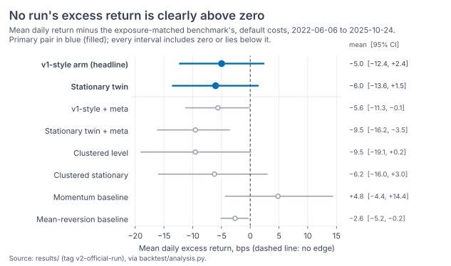
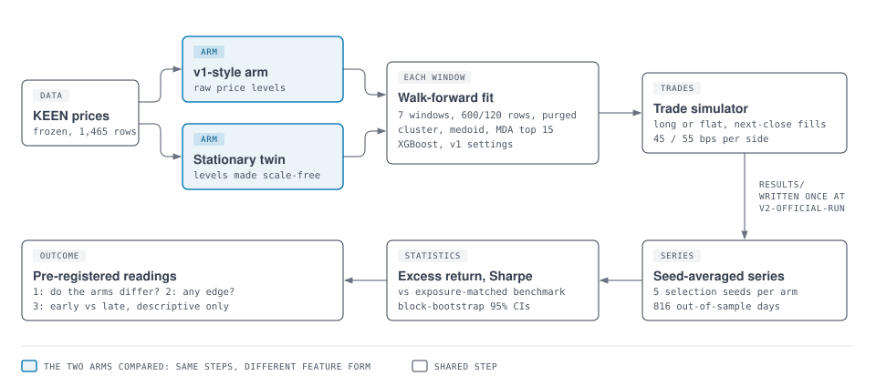
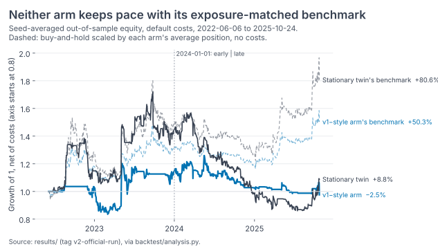

# Financial ML Regime Analysis

**A machine-learning trading model for one Indonesian stock, rebuilt after its original results turned out to be wrong. Re-tested with every rule fixed before the run, it shows no edge over simply holding the stock for the same share of the time.**

**In 30 seconds**

- **What it is.** An XGBoost model decides each day whether to hold KEEN, a small stock on the Indonesia Stock Exchange (IDX), or stay in cash. It is tested walk-forward on 816 trading days (June 2022 to October 2025), net of real IDX trading costs.
- **Why it was rebuilt.** The project's first version (the [`v1` tag](https://github.com/Abhinawap/financial-ml-regime-analysis/tree/v1), October 2025) reported a Sharpe ratio of 9.59 and blamed its later collapse on a market "regime change". The 9.59 was a count of correct predictions, not a return, and the pipeline leaked future data. This version rewrites the evaluation from scratch.
- **What it found.** Neither model beats its benchmark: both trail by 5 to 6 basis points a day, with 95% confidence intervals that include zero. With no edge to begin with, there was nothing for a regime change to break.
- **Why the result can be trusted.** The question, settings and pass/fail rules were committed to git before the official run, the outputs were committed before anyone opened them, and 142 tests run in CI.

Built with Python 3.12, pandas, scikit-learn, XGBoost and SciPy; walk-forward validation with purged training rows, a trade simulator with IDX costs, and block-bootstrap confidence intervals.

**Terms used below.** The **price-level model** is fed raw prices, as the first version was. The **returns-based model** is fed the same features as ratios to today's price, so it never sees the price level. The **exposure-matched benchmark** is buy-and-hold scaled by the share of days a model holds the stock: what that much time in the market earns with no skill. **Excess return** is a model's daily return minus that benchmark's, and 1 basis point (bp) is 0.01%. (The spec and code call the two models the *v1-style arm* and the *stationary twin*; see [`GLOSSARY.md`](GLOSSARY.md).)



*This plot was designed after the official outputs were read. It shows the pre-registered excess-return statistic and adds no new analysis ([Amendment 5](docs/spec.md#amendment-5-from-1s-comments)).*

## The first version's Sharpe of 9.59 was not a return

The first version scored each prediction +1 when it matched the outcome and −1 when it did not, then reported those scores as returns ([`calculate_weighted_returns`](https://github.com/Abhinawap/financial-ml-regime-analysis/blob/v1/notebook/trading_strategy_analysis.ipynb?plain=1#L20114-L20129)). Its validation Sharpe of 9.59 and walk-forward "−124%" were both computed from that score. It also leaked: labels near each train/test boundary read the next period's prices, and later windows reused features chosen on the full training set. There were no trading costs, and it took short positions that retail investors in KEEN could not take. The full list is in [What the first version got wrong](#what-the-first-version-got-wrong).

## Two explanations fit the collapse, and only one was ever claimed

The first version said its strategy, learned in a choppy market, failed when the market started trending in 2024. A simpler explanation also fits. It fed the model 30 days of raw closing prices, and tree models like XGBoost cannot predict well at price levels they never saw in training. A model built on price levels may break whenever the price moves into a new range, regime change or not.

## Two models that differ only in how prices are fed in



The price-level model keeps the first version's features exactly as they were, inside the corrected pipeline. The returns-based model replaces every price level with a ratio (each past close becomes log(past close / today's close)). Everything else is shared: seven walk-forward windows that each retrain on 600 days and test on the next 120 (96 in the last), a long-or-cash trade simulator that fills at the next close with IDX costs, five random seeds for feature selection, and the same benchmark. If raw prices caused the collapse, the returns-based model should do clearly better.

Three questions and their pass/fail rules were written into the [spec](docs/spec.md) before the run (the spec calls them readings 1 to 3):

1. **Does feature form matter?** Inconclusive. Both tests fail, so neither model is shown to be better.
2. **Is there any edge?** No. Neither model's excess return is clearly above zero.
3. **Did performance change after 2024?** Both models are ahead early and behind late, but with no edge (question 2) this cannot count as evidence of a regime change. It is reported as a description only.

## Neither model beats its benchmark, and feature form makes no detectable difference



*Out-of-sample equity averaged over the five seeds, net of costs, each model's exposure-matched benchmark dashed. The same series as the notebook's `results/headline.png`, the figure the spec names, restyled for this page.*

816 out-of-sample days, default costs (45 bps per buy, 55 bps per sell), risk-free rate zero, 95% block-bootstrap intervals:

| Model | Return | Sharpe [95% CI] | Excess return, bps/day [95% CI] | Break-even cost | Trades per seed | Share of days held | Max drawdown (benchmark) | Time under water, days (benchmark) |
|---|---|---|---|---|---|---|---|---|
| **Price-level model (headline)** | **−2.5%** | **0.08 [−1.01, 0.99]** | **−4.97 [−12.37, +2.45]** | **None** | **26.8** | **41%** | **−22.5% (−21.4%)** | **344, not recovered (469)** |
| Returns-based model | +8.8% | 0.23 [−0.90, 1.21] | −6.01 [−13.60, +1.48] | 15 bps | 57.4 | 64% | −50.0% (−32.1%) | 494, not recovered (471) |

Break-even is the round-trip cost at which excess return is zero; "None" means the model trails its benchmark even before costs. The returns-based model's 15 bps is far below the roughly 100 bps a real round trip costs.

Drawdown and time under water are given for each model and, in brackets, its exposure-matched benchmark, which pays no costs and so is slightly favoured ([Amendment 7](docs/spec.md#amendment-7-from-1s-comments)). "Not recovered" means the model was still below its earlier peak on the last day. With the same average exposure, the returns-based model fell 50% from its peak against its benchmark's 32%. The benchmark holds 64% of the stock every day, while each of the model's runs is either fully in or out, and the model lost 12.4%, 19.6% and 11.3% in windows 4 to 6 ([per-window table](#neither-model-beats-its-benchmark-and-feature-form-makes-no-detectable-difference)): through KEEN's 2024 fall, then a 2025 rebound in which that window's benchmark gained 22.6%.

The returns-based model's +8.8% against −2.5% is not a ranking. The gap in mean per-seed Sharpe, 0.14, is a quarter of the 0.59 that changing only the random seed produces, so question 1 fails both its tests:

1. The 95% CI on the daily return difference, [−12.29, +7.30] bps, includes zero.
2. The Sharpe gap of −0.14 is smaller than the seed spread of 0.59.

The spec predicted the seed test might fail for the price-level model: its 30 raw price lags are so correlated that which ones get selected is close to arbitrary. Its per-seed Sharpe runs from −0.19 to 0.40 on the seed alone; the returns-based model's from −0.05 to 0.49.

<details>
<summary><b>Per window: the early-late pattern rests on a few windows</b></summary>

Compounded return per test window. Each window's exposure-matched benchmark is scaled by the model's share of days held in that window. Excess is in percentage points. Descriptive, not tested.

| Window | Test days | Period | Price-level model | Its benchmark | Excess | Returns-based model | Its benchmark | Excess |
|---|---|---|---|---|---|---|---|---|
| 1 | 2022-06-06 to 2022-11-21 | early | +3.6% | +5.2% | −1.6 | +37.6% | +25.6% | +12.0 |
| 2 | 2022-11-22 to 2023-05-23 | early | +6.1% | −11.8% | +17.9 | −1.6% | −10.1% | +8.5 |
| 3 | 2023-05-24 to 2023-11-17 | early | +2.5% | +5.2% | −2.8 | +9.8% | +7.7% | +2.2 |
| 4 | 2023-11-20 to 2024-05-31 | late | +2.3% | −4.7% | +7.0 | −12.4% | −5.5% | −7.0 |
| 5 | 2024-06-03 to 2024-11-20 | late | −10.8% | −9.4% | −1.4 | −19.6% | −12.8% | −6.9 |
| 6 | 2024-11-21 to 2025-06-05 | late | −1.8% | +4.7% | −6.5 | −11.3% | +22.6% | −33.9 |
| 7 | 2025-06-10 to 2025-10-24 | late | −3.4% | +2.4% | −5.8 | +17.2% | +12.8% | +4.4 |

Windows 1–6 have 120 test days and window 7 has 96. A window is early or late by whether most of its test days fall before or after 2024-01-01, the split the first version claimed. Question 3 uses mean daily excess return: the price-level model averages +4.21 bps early and −1.18 late, the returns-based model +6.54 early and −9.57 late. With three windows against four, no test is run. Window 2 alone produces the price-level model's early lead, and its late average of −1.18 bps a day is close to zero. Window 6 (−33.9) accounts for most of the returns-based model's late deficit.

</details>

<details>
<summary><b>KEEN itself rose in both periods but fell 23% in 2024</b></summary>

Buy-and-hold, no costs.

| Period | Dates | Buy-and-hold return | Annualised volatility | Sharpe |
|---|---|---|---|---|
| Early | 2022-06-06 to 2023-12-29 | +72.1% | 53% | 0.92 |
| Late | 2024-01-02 to 2025-10-24 | +30.5% | 37% | 0.61 |
| Calendar 2024 | 2024-01-02 to 2024-12-30 | −23.0% | 25% | −0.98 |

The first version described 2024–25 as a strong sustained uptrend; the 2024 fall contradicts that. These figures match the ones quoted in the spec before the run, to rounding, a check on the data behind every benchmark.

</details>

<details>
<summary><b>Higher costs: both models trail by more at 150 and 200 bps</b></summary>

Costs never change a trading decision, so these are recomputed from gross returns and trade dates.

| Round trip | Price-level return | Price-level excess, bps/day [95% CI] | Returns-based return | Returns-based excess, bps/day [95% CI] |
|---|---|---|---|---|
| 100 bps | −2.5% | −4.97 [−12.37, +2.45] | +8.8% | −6.01 [−13.60, +1.48] |
| 150 bps | −14.7% | −6.61 [−13.99, +0.82] | −18.4% | −9.53 [−17.09, −2.12] |
| 200 bps | −25.5% | −8.26 [−15.64, −0.81] | −38.8% | −13.05 [−20.62, −5.60] |

</details>

<details>
<summary><b>Bootstrap block length: 5, 10 or 20 days gives the same answer</b></summary>

The spec set the bootstrap's mean block length to 10 days without recording a reason. Block length cannot move the mean, only the interval's width. The method and the rule that every reading stays on 10 days were fixed before these were computed ([Amendment 7](docs/spec.md#amendment-7-from-1s-comments)).

| Mean block length | Price-level excess, bps/day [95% CI] | Returns-based excess, bps/day [95% CI] |
|---|---|---|
| 5 days | −4.97 [−12.60, +2.91] | −6.01 [−13.73, +1.57] |
| 10 days (used throughout) | −4.97 [−12.37, +2.45] | −6.01 [−13.60, +1.48] |
| 20 days | −4.97 [−12.23, +2.13] | −6.01 [−13.56, +1.22] |

Every interval includes zero.

</details>

<details>
<summary><b>A second "veto" model (meta-labelling) made both worse</b></summary>

Each model plus a second model, trained on out-of-fold predictions, that vetoes buy calls it rates below 0.5.

| Run | Return | Sharpe [95% CI] | Excess return, bps/day [95% CI] | Break-even | Trades per seed |
|---|---|---|---|---|---|
| Price-level | −2.5% | 0.08 [−1.01, 0.99] | −4.97 [−12.37, +2.45] | None | 26.8 |
| Price-level + meta | −15.0% | −0.26 [−1.18, 0.63] | −5.62 [−11.30, −0.08] | None | 29.6 |
| Returns-based | +8.8% | 0.23 [−0.90, 1.21] | −6.01 [−13.60, +1.48] | 15 bps | 57.4 |
| Returns-based + meta | −31.6% | −0.49 [−1.55, 0.45] | −9.51 [−16.22, −3.54] | None | 56.4 |

No test of the difference was pre-registered. The price-level + meta run trades more than its base run (29.6 against 26.8 per seed), although the veto only removes calls: a veto on a review day ends a trade the base run would have extended, so resets fall from 45.4 to 22.0 per seed and long trades split into shorter ones (8.1 days held on average against 12.4). No window needed the fallback for a window without out-of-fold buy calls (0 of 35 in each model). The spec estimated about 190 out-of-fold buy calls per window; the returns-based model's median was 205, the price-level model's 88.

</details>

<details>
<summary><b>Feature clustering on every column: too few candidates for the seeds to matter</b></summary>

Both feature forms with every feature, lags included, going through clustering. No pass/fail rules.

| Run | Return | Sharpe [95% CI] | Excess return, bps/day [95% CI] | Break-even | Trades per seed |
|---|---|---|---|---|---|
| Clustered price-level | −28.0% | −0.25 [−1.51, 0.83] | −9.54 [−19.09, +0.15] | None | 35.0 |
| Clustered returns-based | +5.2% | 0.20 [−0.79, 1.03] | −6.22 [−16.03, +3.02] | 4 bps | 53.0 |

Clustering leaves 6–8 candidates in the price-level form and 10–12 in the returns-based form, below the 15 that feature selection keeps. Every candidate is selected, so all five seeds give identical results.

</details>

<details>
<summary><b>Simple rules: momentum made +107%, still with no clear excess return</b></summary>

Simple rules through the same trade simulator and default costs.

| Baseline | Return | Sharpe [95% CI] | Excess return, bps/day [95% CI] | Break-even | Trades | Share of days held |
|---|---|---|---|---|---|---|
| Buy-and-hold | +122.1% | 0.76 [−0.31, 1.71] | −0.11 [−0.37, +0.03] | 14 bps | 1 | 100% |
| Momentum (60-day return > 0) | +107.2% | 0.75 [−0.38, 1.67] | +4.83 [−4.42, +14.41] | 403 bps | 13 | 53% |
| Mean reversion (RSI(14) < 30) | −14.3% | −0.63 [−1.47, 0.21] | −2.64 [−5.16, −0.25] | None | 6 | 6% |

Don't compare buy-and-hold's +122% with the models' single-digit returns: the models hold the stock 41% and 64% of the time, so most of that gap is time out of the market, which is why excess return is the measure of skill. Buy-and-hold is out of the stock only on its first day, so its benchmark is scaled by 815/816: its excess return is just its two costs, and its break-even is an artefact of that scaling. Momentum's excess interval includes zero, like every other. Mean reversion's signal fired in 11 episodes, as the spec estimated, but made only 6 trades: with one trade at a time, an episode that starts while a position is open adds no trade.

</details>

## The rules were fixed in git before the run

The spec, every setting and the pass/fail rules were committed before the official run, and the analysis notebook was committed and pushed before it read the official outputs:

| Step | Commit |
|---|---|
| Code that produced the results, tagged [`v2-official-run`](https://github.com/Abhinawap/financial-ml-regime-analysis/tree/v2-official-run) | `6391a43` |
| Official outputs committed unopened | `dc2c165` |
| [Analysis notebook](notebook/v2_analysis.ipynb) and Amendment 4, built on synthetic rehearsal outputs | `8bf700a` |
| Notebook run on the official outputs, code unchanged apart from its data path | `46074e6` |

**What this does not prove.** The data was not unseen. The first version's results, the price path and every figure quoted while planning came from the same out-of-sample period. Pre-registration proves the analysis plan came before these results, not that the data was fresh. The spec's planned second pass, on one liquid asset nobody has looked at, is the test that would.

<details>
<summary><b>Amendments, deviations and data</b></summary>

**Amendments.** The spec carries eight dated amendments, each recorded on [#1](https://github.com/Abhinawap/financial-ml-regime-analysis/issues/1). The first four came before the official outputs were opened: results saved to files, the meta-model fallback, guards on the official run, and two rules for computing the readings. The fifth and sixth came after: presentation changes that put the excess-return plot first on this page ([Amendment 5](docs/spec.md#amendment-5-from-1s-comments)) and give the two models plain names here and in the charts ([Amendment 6](docs/spec.md#amendment-6-from-1s-comments)). The seventh and eighth, also after, add three descriptive figures whose methods were fixed before any of them was computed: drawdown, a bound on the dividend-adjustment look-ahead, and a block-length check ([Amendment 7](docs/spec.md#amendment-7-from-1s-comments)). `scripts/amendment7.py` computes them, so the notebook stays as it ran ([Amendment 8](docs/spec.md#amendment-8-from-1s-comments)). **Deviation log:** no deviations. No bug has been found in the official run's code since it ran.

**Data.** `data/KEEN_2019_2025.csv`, daily, dividend-adjusted, 2019-10-01 to 2025-10-24, 1,465 rows, sha256 `4a90304fa95b3e8adaf736e4876dfd03713585f7599e5d34bcd04a570d27f71d`. Yahoo rewrites adjusted prices after every dividend, so the file is frozen and never re-downloaded. Adjustment puts a small look-ahead into price levels, bounded under [Limitations](#limitations). (`results/run.json` records a different hash, `prices_sha256`, which is of the loaded price table rather than the file.)

</details>

## Limitations

- **Low statistical power.** Buy-and-hold's own Sharpe interval is [−0.31, 1.71], so only a large gap between models could be detected.
- **One illiquid stock.** Capacity is about 1% of KEEN's daily traded value, roughly IDR 10 m on a median day ([liquidity research](docs/research/idx-trading-frictions.md#5-liquidity)). The returns do not scale.
- **Simple execution model.** Close-to-close fills, with no tick rounding, lot sizes, order of barrier touches within a day, or gap fills.
- **Adjusted prices leak future dividends into price levels.** Yahoo adjusts for a dividend by scaling every close before its ex-date down by the dividend's share of the price, so a price level on day t depends on dividends paid after t. Ratios between closes on or before t are scaled only by dividends already paid, so the returns-based model, the labels and the returns are clean. The leak reaches the price-level model and the clustered price-level run. It is small: KEEN paid six dividends in the data, and no adjusted price is more than 5.82% below the real traded price, or 4.14% from the first out-of-sample day on ([dividend research](docs/research/keen-dividends.md)). Look-ahead would normally flatter a model, but a distortion of its features need not help it, so the direction is unknown. The price-level model shows no edge with the leak in place, and nothing was rerun on unadjusted prices. The test uses KEEN because the question is whether the first version's failure on KEEN was a regime change.

<details>
<summary><b>Six more limitations</b></summary>

- **No limit-down rule.** 2022-09-07 is the one out-of-sample day at the lower auto-rejection limit (−7.0%), where a sell order might not have filled. Neither ML model held KEEN that day. Buy-and-hold and momentum held through it without trading.
- **Ward linkage on a non-Euclidean distance.** Clustering uses Ward on 1 − |correlation|, kept for comparability with the first version.
- **Meta fold models are weaker than the deployed model.** They train on as few as about 100 rows, against about 590 for the model that trades. Feature selection also sees the whole training window, labels included, before the out-of-fold predictions, so those predictions look slightly better than the deployed model's.
- **The last few selected features are noise.** The first version's feature-importance scores (MDA) fall below 0.001 after the eleventh feature.
- **Risk-free rate of zero.** Indonesian cash yields were near 6% in this period. Excess return is unaffected.
- **Benchmark offset.** The exposure-matched benchmark scales buy-and-hold by the average of each day's closing position, as the spec defines it. The return on day t is earned by the position held from close t−1, so the average is offset by one day: one day in 816 for the headline, about one in 120 per window.

</details>

## What the first version got wrong

- Its "returns" were a hit score: +1 when the predicted label matched the actual one and −1 when not, times bet size ([`calculate_weighted_returns`](https://github.com/Abhinawap/financial-ml-regime-analysis/blob/v1/notebook/trading_strategy_analysis.ipynb?plain=1#L20114-L20129)). Its validation Sharpe of 9.59 and walk-forward "−124%" are hit scores, not returns.
- Walk-forward windows reused features selected on the full 2019–2023 training set ([here](https://github.com/Abhinawap/financial-ml-regime-analysis/blob/v1/notebook/trading_strategy_analysis.ipynb?plain=1#L21591)), and the meta-model trained on the primary model's in-sample predictions, and was trained to predict `label != 0`, a different question from the main pipeline's ([here](https://github.com/Abhinawap/financial-ml-regime-analysis/blob/v1/notebook/trading_strategy_analysis.ipynb?plain=1#L21616-L21632)).
- Labels were computed before the train/validation/test split, so labels near each boundary read the next period's prices, and consecutive walk-forward test windows overlapped by half, which inflated its t-test.
- There were no trading costs, and the strategy took short positions in a stock retail investors could not short from March 2020.

The full list is in the [spec](docs/spec.md#problem-statement). The first version's notebook is unchanged apart from a banner cell pointing here.

## Reproducing

Requires [uv](https://docs.astral.sh/uv/); the lock file pins Python 3.12.11 and every package.

```bash
git clone https://github.com/Abhinawap/financial-ml-regime-analysis.git
cd financial-ml-regime-analysis
uv sync

uv run pytest                                      # tests use synthetic prices and development rows only
uv run jupyter lab notebook/v2_analysis.ipynb      # reads results/, fits no model
uv run python docs/img/make_charts.py              # rebuilds the README charts from results/
uv run python -m scripts.amendment7 results        # drawdown and block-length figures
```

To rerun the official results from the tagged code:

```bash
git checkout v2-official-run
OMP_NUM_THREADS=1 uv run python -m backtest.results --official-run --out results-rerun
git checkout main                                  # the v2 notebook was added after the tag
```

Then set `RESULTS = "results-rerun"` at the top of the notebook. `requirements.txt` is exported from the lock file, for installing with pip on Python 3.12.11 instead.

## Repository layout

```
backtest/                        trade simulator, walk-forward run, statistics, results command, analysis
tests/                           tests for each part, on synthetic prices and development rows
notebook/v2_analysis.ipynb       analysis: every table and figure above except Amendment 7's
scripts/amendment7.py            drawdown and block-length figures (Amendment 7)
scripts/rehearsal.py             full-size run and analysis on synthetic prices
notebook/trading_strategy_analysis.ipynb   the first version's analysis, unchanged apart from a banner
results/                         official run outputs and the notebook's headline figure
docs/img/                        README charts (make_charts.py) and the pipeline diagram
data/KEEN_2019_2025.csv          frozen price data
docs/spec.md                     the pre-registered spec (copy of #1, with amendments)
docs/research/                   IDX trading costs, short-selling rules, liquidity and KEEN's dividends
GLOSSARY.md                      the project's terms
```

## License and disclaimer

MIT, see [LICENSE](LICENSE). This project is for education and research only. It is not financial advice and should not be used for live trading.

## Author

**Bambang Abhinawa Pinakasakti**, Computer Science, University of Birmingham. [LinkedIn](https://www.linkedin.com/in/bambang-abhinawa-pinakasakti-6955092b4/) · [GitHub](https://github.com/Abhinawap)
